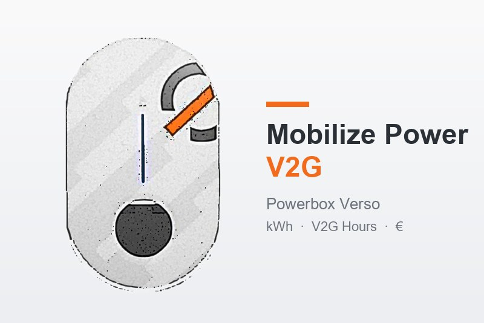

# Mobilize Power V2G pour Gladys Assistant

Suivez dans Gladys les recharges et les renvois d'énergie de votre voiture sur une **borne Mobilize Powerbox Verso**, avec l'offre **Mobilize Power** : coût de la recharge, gain des heures V2G, abonnement et bilan, par jour, par mois et par année.

## Ce qu'il faut

- Une borne **Mobilize Powerbox Verso** sur votre réseau local (Wi-Fi ou Ethernet), avec une **adresse IP fixe** (à régler dans votre box).
- Le **mot de passe du compte installateur** de la borne, imprimé sur son étiquette (utilisateur `installer`).

L'intégration lit la borne **en lecture seule** : elle ne modifie jamais ses réglages et ne gêne pas le service Mobilize Power ni l'application My Renault.

## Réglages

1. Onglet **Configuration** : adresse IP de la borne, utilisateur et mot de passe, puis **Tester la connexion à la borne**. Gladys masque la saisie du mot de passe : ce bouton confirme qu'il est bon (« OK ») ou refusé.
2. **Puissance souscrite** de votre contrat (pour l'abonnement).
3. Onglet **Découverte** : créez l'appareil « Mobilize Power V2G ».
4. Tableau de bord : ajoutez le widget **Bilan V2G** et choisissez la période (aujourd'hui, ce mois, cette année).

### Mise à jour depuis la version 0.1

La version 0.1 lisait mal la présence de la voiture (toujours « branchée ») et déclarait des capteurs que Gladys doublait en « (consumption) » et « (cost) ». Après la mise à jour :

1. Supprimez l'appareil « Mobilize Power V2G » (onglet **Appareils**).
2. Recréez-le depuis l'onglet **Découverte**.

Les heures V2G estimées avant la mise à jour sont remises à zéro ; l'énergie et les heures officielles saisies sont conservées.

## Le calcul

| Ligne | Calcul |
|---|---|
| Coût de la recharge | kWh chargés × prix du kWh |
| Abonnement | abonnement annuel × jours de la période ÷ jours de l'année |
| Bonus V2G | heures V2G × tarif V2G Hour |
| Rachat de l'énergie renvoyée | kWh renvoyés × prix de rachat (0 par défaut) |
| **Bilan** | recharge + abonnement − bonus V2G − rachat |

Un bilan négatif est un gain.

### Les tarifs

Par défaut, l'intégration lit une fois par jour la **grille tarifaire** publiée sur [mobilize-v2g.fr](https://www.mobilize-v2g.fr/fr_fr) (le PDF en bas de page). Si la lecture échoue, elle garde la dernière grille lue, ou la grille d'août 2026 intégrée (0,1823 €/kWh, V2G Hour 0,1076 €, abonnement selon la puissance de 3 à 36 kVA).

Chaque valeur saisie dans la configuration (prix du kWh, tarif V2G Hour, abonnement annuel) **l'emporte sur la grille**. Laissez un champ vide pour suivre la grille. Le bouton **Lire la grille tarifaire Mobilize maintenant** force une lecture.

Le **rachat de l'énergie renvoyée** est à 0 par défaut : le gain V2G vient des heures branchées. La fiche d'information Mobilize indique un rachat au prix de vente ; si votre facture le montre, saisissez le prix.

### Les heures V2G sont estimées

Mobilize compte les heures V2G à la minute, une fois le niveau de charge minimum atteint et jusqu'à l'heure de départ, au préconditionnement ou au débranchement. La borne n'expose pas ces informations : l'intégration compte le **temps où la voiture est branchée**, ce qui surestime un peu. La voiture est détectée par le signal pilote de la prise : un câble laissé dans la borne sans voiture ne compte pas.

Saisissez le chiffre officiel d'un mois (appli My Renault ou facture) avec le bouton **Heures V2G officielles** du widget, ou l'action du même nom dans la configuration. Il remplace l'estimation pour ce mois.

## Les capteurs

- En direct : puissance de la borne, voiture branchée, compteurs d'énergie chargée et renvoyée de la borne.
- Pour aujourd'hui et pour le mois : énergie chargée, énergie renvoyée, heures V2G, coût de recharge, abonnement, bonus V2G, rachat, bilan.

## Limites

- L'API locale de la borne n'est pas documentée par Mobilize : une mise à jour de la borne pourrait la changer.
- Si la borne ou Gladys est injoignable plus de 10 minutes, ce temps n'est pas compté en heures V2G ; l'énergie, elle, est rattrapée grâce aux compteurs de la borne.
- Les montants sont TTC, calculés avec les prix de la grille : la facture peut légèrement différer (taxes selon votre situation).
- Dans **Découverte**, Gladys affiche l'icône « $ » pour tous les capteurs de type Monnaie, quelle que soit la devise : les montants sont bien en euros (unité €).
